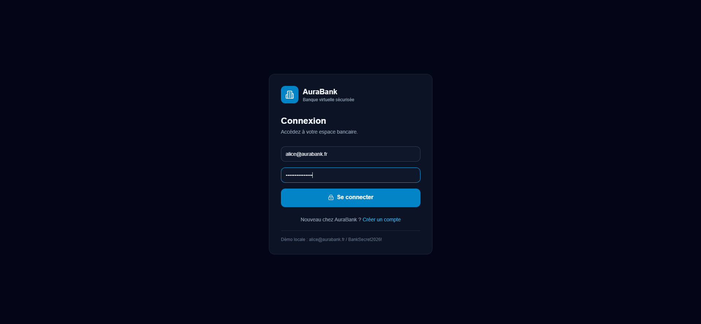
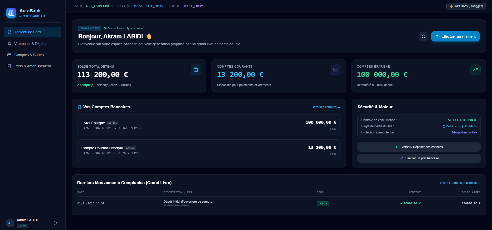
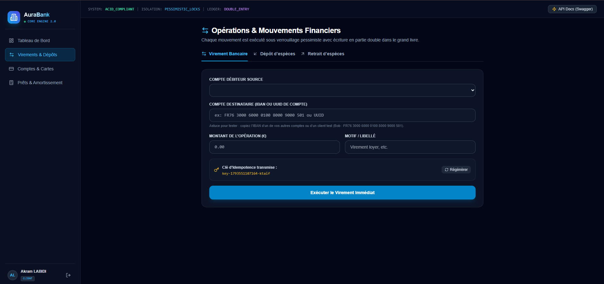
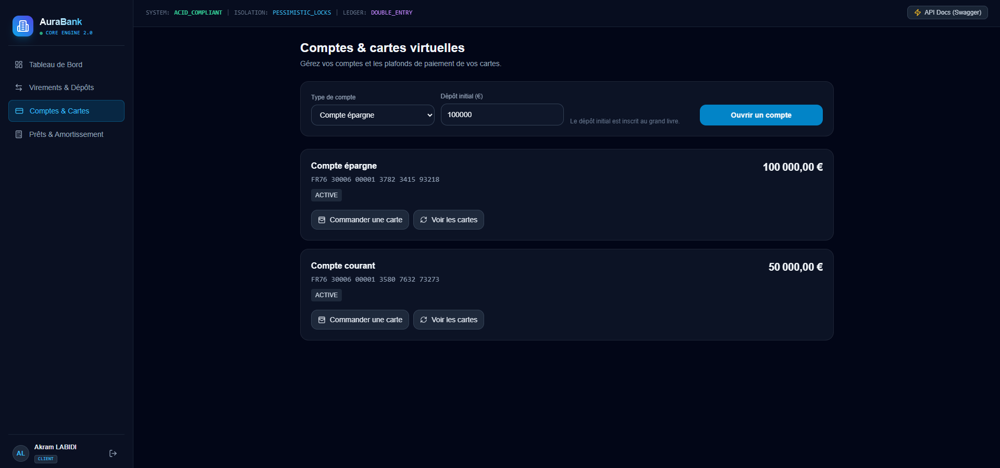
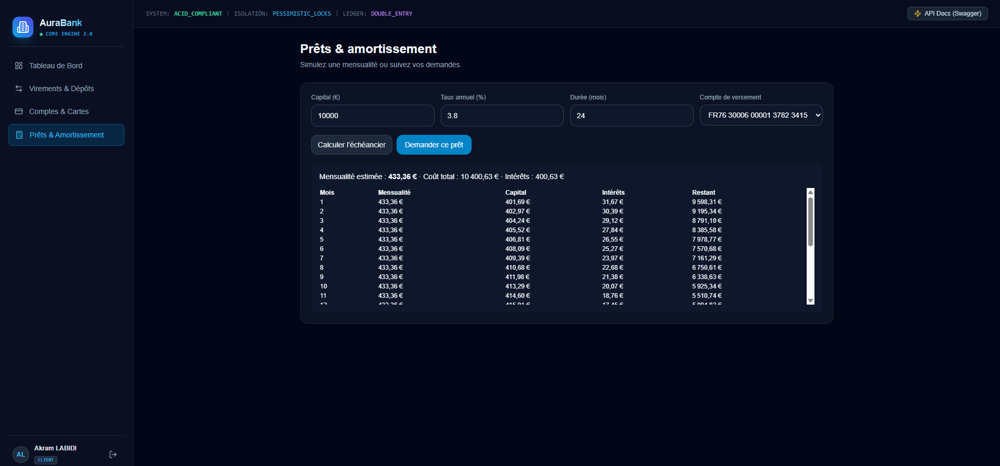

# AuraBank — Virtual Banking System

<p align="center">
  
  
  
  
  
</p>

A virtual banking demo built to showcase a modern banking system, including a transaction engine, double-entry ledger, concurrency controls, role-based access control (RBAC), and a polished web interface.

> **Disclaimer:** This project is intended for learning, demonstrations, and portfolio use. It is not a real banking system and must not be used to process real funds, payments, or sensitive data without professional security reviews, regulatory audits, secure secret management, and production-ready database migrations.

## Contents

- [Project overview](#project-overview)
- [Key features](#key-features)
- [Screenshots](#screenshots)
- [Architecture](#architecture)
- [Technology stack](#technology-stack)
- [Prerequisites](#prerequisites)
- [Quick start](#quick-start-windows--powershell)
- [Demo accounts](#demo-accounts)
- [Useful commands](#useful-commands)
- [Troubleshooting](#troubleshooting)
- [Configuration and limitations](#configuration-and-known-limitations)
- [Security](#security-considerations)

## Project Overview

AuraBank demonstrates a robust banking application architecture through:

- A secure NestJS API
- Double-entry accounting
- Concurrency control and idempotency
- Role-based access for different user types
- A user-focused banking interface
- A modern technology stack suitable for demonstrating full-stack engineering skills

---

## Key Features

- Customer registration and JWT authentication with token refresh
- Role management for customers, advisors, and administrators
- Checking and savings account creation
- Deposits, withdrawals, internal transfers, and balance checks
- Double-entry ledger with journal validation
- Account locking and transactional processing
- Idempotency keys to prevent duplicate operations
- Fraud alerts and SHA-256 audit logs
- Simulated virtual cards with limits and business rules
- Loan application simulations and staff approvals
- Traffic simulator restricted to authorized roles
- Swagger API documentation and a role-protected user interface

---

## Screenshots

### Sign in



### Dashboard



### Transfers and deposits



### Accounts and cards



### Loans and repayment schedule



---

## Architecture

```text
React + Vite (5173)
        │ /api (Vite proxy)
        ▼
NestJS (3000) ── auth, accounts, transactions, ledger,
        │          fraud, cards, loans, audit, simulator
        ▼
PostgreSQL (5432) via TypeORM
```

The ledger records each operation within a database transaction. Affected accounts are locked in a deterministic order to prevent inconsistencies. Reusing an idempotency key for the same operation returns the original result; reusing it for a different operation is rejected.

---

## Technology Stack

### Backend

- NestJS
- TypeScript
- TypeORM
- PostgreSQL
- JWT / Passport
- Swagger
- Class-validator / Class-transformer

### Frontend

- React
- Vite
- TypeScript
- Tailwind CSS

---

## Prerequisites

- Node.js 20 or later
- npm
- Docker Desktop
- Git

---

## Quick Start (Windows / PowerShell)

Open PowerShell in the project root (the folder containing `docker-compose.yml` and this README). You need two terminals: one for the API and one for the web app.

### 1. Start PostgreSQL and configure the backend

In the first terminal, run:

```powershell
docker compose up -d postgres
Copy-Item backend\.env.example backend\.env
```

Run `Copy-Item` only if `backend\.env` does not already exist. Open that file and set distinct values for `JWT_SECRET` and `JWT_REFRESH_SECRET`. You can generate a secret in PowerShell with:

```powershell
[Convert]::ToBase64String([Security.Cryptography.RandomNumberGenerator]::GetBytes(48))
```

Run it twice and use a different result for each secret. Keep this terminal at the project root.

### 2. Install and start the backend

In the first terminal:

```powershell
npm install --prefix backend
npm run dev:backend
```

Leave the backend running. On startup, it should report that the API is listening on port `3000`.

### 3. Install and start the frontend

Open a second PowerShell terminal in the project root and run:

```powershell
npm install --prefix frontend
npm run dev:frontend
```

Leave the frontend running, then open:

- Web app: <http://localhost:5173>
- API documentation (Swagger): <http://localhost:3000/api/docs>
- API health: <http://localhost:3000/api/health>

---

## Demo Accounts

To create the demo users, set `SEED_DEMO_DATA=true` in `backend\.env` before starting the backend while the database contains no users. The seed runs at startup only if there are no users in the database; it does not add demo users to a database that already contains users. If you change this setting while the backend is running, restart the backend.

Demo accounts share this password:

```text
BankSecret2026!
```

| Role | Email |
|---|---|
| Customer | `alice@aurabank.fr` |
| Customer | `bob@aurabank.fr` |
| Advisor | `conseiller@aurabank.fr` |
| Administrator | `admin@aurabank.fr` |

> **Important:** These are public demo credentials. Disable demo seeding and change or remove these accounts before any real-world deployment.

If demo data is disabled, you can register an account from the sign-up page. Public registration is limited to customer accounts.

---

## Useful Commands

Run these commands from the project root:

| Command | Description |
|---|---|
| `npm run dev:backend` | Start the NestJS backend in watch mode |
| `npm run dev:frontend` | Start the Vite frontend |
| `npm run build` | Build both the backend and frontend |
| `npm test` | Run the backend tests |
| `npm run test:concurrency` | Run the transaction engine concurrency test |

---

## Troubleshooting

- **Login says “Identifiants invalides”:** confirm that demo seeding was enabled before the first backend start and that the database was empty then. Check the backend terminal for a `[SEED]` message. If the seed reports that the database is already initialized, it skipped demo account creation; registering creates a customer account, not an administrator account.
- **The web app cannot reach the API:** make sure PostgreSQL and both development servers are running. The frontend proxies `/api` requests to `http://localhost:3000`.
- **The API does not start:** verify that `backend\.env` exists and that both JWT secrets are set. Check that PostgreSQL is healthy with `docker compose ps`.
- **Port already in use:** stop the other process using port `5173`, `3000`, or `5432`, or adjust the relevant project configuration.

---

## Configuration and Known Limitations

- `DB_TYPE=postgres` is the recommended configuration.
- SQLite can be used for simple local testing, but it does not provide the same row-locking guarantees.
- `SEED_DEMO_DATA` is disabled by default.
- TypeORM `synchronize` is disabled in production. TypeORM migrations must be added and run before deployment.
- Cards and card-related operations are simulations only.
- API and PostgreSQL health status is available at `/api/health`.

---

## Security Considerations

This project is an educational example and is not a substitute for a professional security review. Before considering a production deployment, review:

- JWT secret generation and rotation
- Environment variable and secret management
- RBAC permissions and authorization rules
- Logging and audit mechanisms
- Database migrations and backup strategy
- Regulatory requirements for the intended use case

---

## Contributing

Contributions are welcome. To propose an improvement:

1. Fork the repository.
2. Create a dedicated branch.
3. Implement your changes.
4. Run the tests and build locally.
5. Open a pull request with a clear description.

---

## License

This project is provided for educational and demonstration purposes. Review the applicable terms before any commercial or institutional reuse.

---

## Acknowledgments

Built to showcase a modern banking application architecture focused on transactional integrity, security, and sound business logic.
